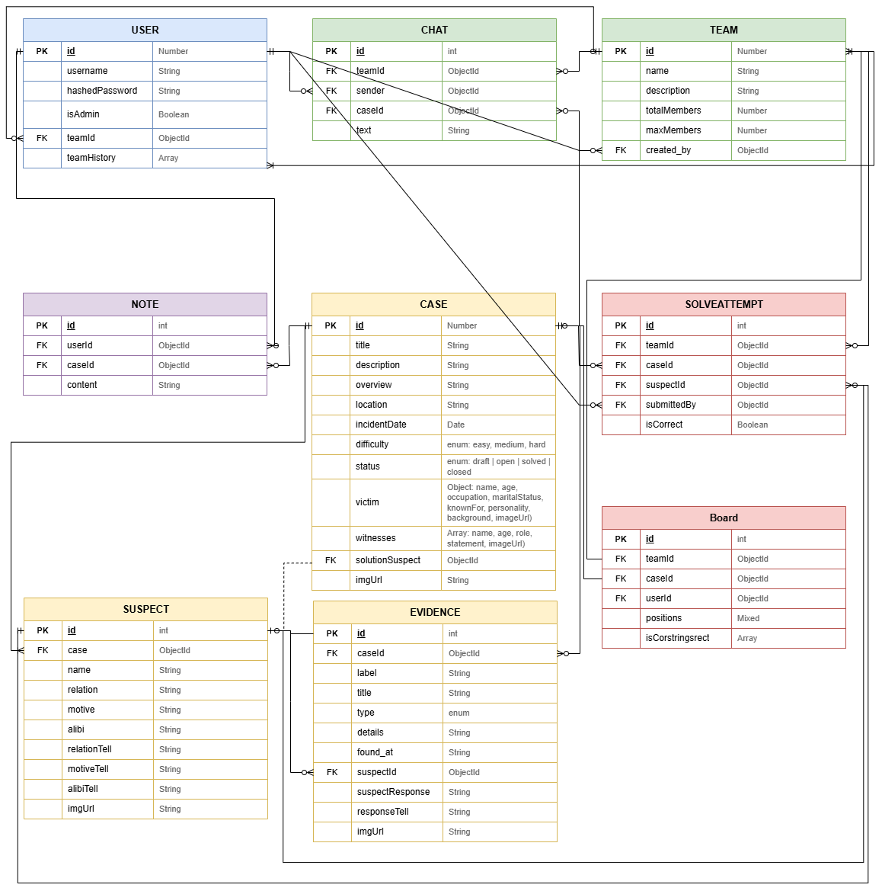

# Casebook Backend API

## Overview

This repository contains the Node.js, Express and MongoDB backend for **Casebook**, a murder-mystery game where players join teams, study case files, question suspects, examine evidence and accuse the culprit. Admins create and manage the cases.

The API handles authentication, cases, suspects, evidence, teams, notes, team chat, the investigation board and solve attempts. Socket.IO pushes live updates, such as new notes, chat messages and board changes, to the players working on a case.

## Related Links

- **Backend API:** https://casebook-bg5e.onrender.com
- **Frontend Application:** https://casesbook.netlify.app
- **Frontend Repository:** https://github.com/FatimaAlsakin/project3-frontend

## Technologies Used

- Node.js
- Express 5
- MongoDB
- Mongoose
- JSON Web Tokens (JWT)
- bcrypt
- Socket.IO
- Cloudinary, Multer and multer-storage-cloudinary (image uploads)
- express-rate-limit

## Features

- User registration and login with hashed passwords and JWTs
- Authentication middleware (`verifyToken`) for protected routes
- Admin-only routes (`isAdmin`) for creating, editing and deleting cases, suspects and evidence
- Full CRUD for cases, suspects, evidence and notes
- Image uploads to Cloudinary for case photos, victims, witnesses, suspects and evidence
- Teams: create, join and leave a team, with each user's team history recorded
- Notes shared between members of the same team
- Team chat for each case
- An investigation board for each team or player, with item positions and the strings linking items
- Solve attempts: each team gets attempts equal to half the number of suspects (rounded up) and can't accuse the same suspect twice; the culprit is revealed once the case is solved or no attempts are left
- Live updates through Socket.IO: notes, chat, board and new evidence
- Dashboard of solved and failed cases for each team and player
- Ownership checks, so only the author can edit or delete a note
- Players only see cases with the status `open`; admins also see `draft` and `closed` cases
- JSON error responses with the correct status codes

## Project Structure

```text
backend/
├── config/
│   ├── cloudinary.js
│   └── db.js
├── middleware/
│   ├── isAdmin.js
│   ├── isInATeam.js
│   ├── rateLimiters.js
│   ├── upload.js
│   ├── validateObjectId.js
│   └── verifyToken.js
├── models/
├── routes/
├── socket/
│   └── index.js
└── server.js
```

### Folder Responsibilities

| Folder / File | Purpose                                                       |
| ------------- | ------------------------------------------------------------- |
| `config`      | MongoDB connection and Cloudinary setup                       |
| `middleware`  | Authentication, admin and team checks, uploads, rate limiters |
| `models`      | Mongoose schemas and models                                   |
| `routes`      | Express routes, each handling its own requests and responses  |
| `socket`      | Socket.IO authentication, rooms and events                    |
| `server.js`   | Express and Socket.IO setup, CORS, routes and server startup  |

## Getting Started

### Prerequisites

Install:

- Node.js
- MongoDB locally or a MongoDB Atlas account
- A Cloudinary account (for image uploads)

## Installation

### 1. Clone the repository

```bash
git clone https://github.com/FatimaAlsakin/project3-backend.git
cd project3-backend
```

### 2. Install dependencies

```bash
npm install
```

### 3. Create the environment file

Create `.env` in the root directory:

```env
PORT=3000
MONGODB_URI=your-connection-string
CLIENT_URL=http://localhost:5173
JWT_SECRET=unique-password-no-one-would-guess
CLOUDINARY_CLOUD_NAME=your-cloud-name
CLOUDINARY_API_KEY=your-api-key
CLOUDINARY_API_SECRET=your-api-secret
```

`CLIENT_URL` can list several origins separated by commas, for example `https://casesbook.netlify.app,http://localhost:5173`.

### 4. Start the development server

```bash
npm run dev
```

The API should be available at:

```text
http://localhost:3000
```

## Database Models

### User

| Field            | Type     | Rules                                                |
| ---------------- | -------- | ---------------------------------------------------- |
| `username`       | String   | Required, unique, trimmed, lowercase                 |
| `hashedPassword` | String   | Required, hashed with bcrypt, never sent in JSON     |
| `isAdmin`        | Boolean  | Default `false`                                      |
| `teamId`         | ObjectId | Ref `Team`, default `null`                           |
| `teamHistory`    | Array    | `{ team, joinedAt, leftAt }` for every team joined   |
| `createdAt`      | Date     | Generated automatically                              |
| `updatedAt`      | Date     | Generated automatically                              |

### Case

| Field             | Type     | Rules                                                                        |
| ----------------- | -------- | ---------------------------------------------------------------------------- |
| `title`           | String   | Required, unique                                                             |
| `description`     | String   | Required                                                                     |
| `overview`        | String   |                                                                              |
| `victim`          | Object   | `name`, `age`, `occupation`, `maritalStatus`, `knownFor`, `personality`, `background`, `imageUrl` |
| `witnesses`       | Array    | `{ name (required), age, role, statement, imageUrl }`                        |
| `location`        | String   | Required                                                                     |
| `incidentDate`    | Date     | Required                                                                     |
| `difficulty`      | String   | `easy`, `medium` or `hard`, default `medium`                                 |
| `status`          | String   | `draft`, `open` or `closed`, default `draft`                                 |
| `solutionSuspect` | ObjectId | Ref `Suspect`                                                                |
| `imageUrl`        | String   |                                                                              |
| `createdAt`       | Date     | Generated automatically                                                      |
| `updatedAt`       | Date     | Generated automatically                                                      |

### Suspect

| Field          | Type     | Rules                                  |
| -------------- | -------- | -------------------------------------- |
| `name`         | String   | Required                               |
| `relation`     | String   | Required                               |
| `motive`       | String   | Required                               |
| `alibi`        | String   | Required                               |
| `relationTell` | String   | Body language for the relation answer  |
| `motiveTell`   | String   | Body language for the motive answer    |
| `alibiTell`    | String   | Body language for the alibi answer     |
| `imageUrl`     | String   | Required                               |
| `case`         | ObjectId | Ref `Case`, required                   |
| `createdAt`    | Date     | Generated automatically                |
| `updatedAt`    | Date     | Generated automatically                |

### Evidence

| Field             | Type     | Rules                                               |
| ----------------- | -------- | --------------------------------------------------- |
| `label`           | String   | Required, trimmed                                   |
| `title`           | String   | Required, trimmed                                   |
| `type`            | String   | `image`, required                                   |
| `imageUrl`        | String   | Required, trimmed                                   |
| `details`         | String   | Required, trimmed                                   |
| `foundAt`         | String   |                                                     |
| `caseId`          | ObjectId | Ref `Case`, required                                |
| `suspectId`       | ObjectId | Ref `Suspect`, default `null`                       |
| `suspectResponse` | String   | What the linked suspect says about this evidence    |
| `responseTell`    | String   | The suspect's body language when answering          |

### Team

| Field          | Type     | Rules                       |
| -------------- | -------- | --------------------------- |
| `name`         | String   | Required, unique, trimmed   |
| `description`  | String   |                             |
| `totalMembers` | Number   | Default `0`                 |
| `maxMembers`   | Number   | Required                    |
| `createdBy`    | ObjectId | Ref `User`, required        |
| `createdAt`    | Date     | Generated automatically     |
| `updatedAt`    | Date     | Generated automatically     |

### Note

| Field     | Type     | Rules      |
| --------- | -------- | ---------- |
| `content` | String   | Required   |
| `userId`  | ObjectId | Ref `User` |
| `caseId`  | ObjectId | Ref `Case` |

### Chat

| Field       | Type     | Rules                   |
| ----------- | -------- | ----------------------- |
| `sender`    | ObjectId | Ref `User`              |
| `caseId`    | ObjectId | Ref `Case`              |
| `teamId`    | ObjectId | Ref `Team`              |
| `text`      | String   | Required                |
| `createdAt` | Date     | Generated automatically |
| `updatedAt` | Date     | Generated automatically |

### Board

| Field       | Type     | Rules                                                    |
| ----------- | -------- | -------------------------------------------------------- |
| `caseId`    | ObjectId | Ref `Case`, required                                     |
| `teamId`    | ObjectId | Ref `Team`                                               |
| `userId`    | ObjectId | Ref `User`                                               |
| `positions` | Mixed    | Item positions on the board, default `{}`                |
| `strings`   | Array    | `{ a, b }`, the pairs of items linked by a string        |
| `createdAt` | Date     | Generated automatically                                  |
| `updatedAt` | Date     | Generated automatically                                  |

Each `caseId`, `teamId` and `userId` combination is unique.

### SolveAttempt

| Field        | Type     | Rules            |
| ------------ | -------- | ---------------- |
| `submitedBy` | ObjectId | Ref `User`       |
| `susbectId`  | ObjectId | Ref `Suspect`    |
| `caseId`     | ObjectId | Ref `Case`       |
| `teamId`     | ObjectId | Ref `Team`       |
| `isCorrect`  | Boolean  | Default `false`  |

## Entity Relationships



- A **User** can belong to one **Team**, and a **Team** has many **Users**.
- A **Case** has many **Suspects** and many **Evidence** items; one **Suspect** is the case's `solutionSuspect`.
- An **Evidence** item can be linked to one **Suspect**.
- A **User** writes many **Notes** for a **Case**; teammates can see each other's notes.
- A **Team** has one **Chat** thread and one **Board** for each **Case**. A player without a team gets their own **Board**.
- A **SolveAttempt** connects a **User**, their **Team**, a **Case** and the accused **Suspect**.

## API Base URL

Local development:

```text
http://localhost:3000
```

Production:

```text
https://casebook-bg5e.onrender.com
```

## Endpoints

Protected routes need the header `Authorization: Bearer <token>`.

### Auth

| Method | Endpoint        | Access | Description                     |
| ------ | --------------- | ------ | ------------------------------- |
| `POST` | `/auth/sign-up` | Public | Register a new user             |
| `POST` | `/auth/sign-in` | Public | Log in and receive an access token |

### Cases

| Method   | Endpoint                       | Access | Description                                          |
| -------- | ------------------------------ | ------ | ---------------------------------------------------- |
| `GET`    | `/cases`                       | Public | Get cases (players see `open` cases, admins see all) |
| `GET`    | `/cases/:Cid`                  | Public | Get one case with its suspects and evidence          |
| `POST`   | `/cases`                       | Admin  | Create a case (with images)                          |
| `PUT`    | `/cases/:Cid`                  | Admin  | Update a case                                        |
| `DELETE` | `/cases/:Cid`                  | Admin  | Delete a case                                        |
| `POST`   | `/cases/:Cid/suspects`         | Admin  | Add a suspect (photo required)                       |
| `PUT`    | `/cases/:Cid/suspects/:sId`    | Admin  | Update a suspect                                     |
| `DELETE` | `/cases/:Cid/suspects/:sId`    | Admin  | Delete a suspect                                     |

### Evidence

| Method   | Endpoint          | Access | Description                          |
| -------- | ----------------- | ------ | ------------------------------------ |
| `POST`   | `/evidence/:cId`  | Admin  | Add evidence to a case (image required) |
| `PUT`    | `/evidence/:eId`  | Admin  | Update evidence                      |
| `DELETE` | `/evidence/:eId`  | Admin  | Delete evidence                      |

### Teams

| Method | Endpoint            | Access        | Description                                  |
| ------ | ------------------- | ------------- | -------------------------------------------- |
| `GET`  | `/teams`            | Authenticated | Get all teams with member counts             |
| `GET`  | `/teams/my-team`    | Authenticated | Get the current user's team and its members  |
| `GET`  | `/teams/dashboard`  | Authenticated | Get the cases closed during each team membership |
| `POST` | `/teams`            | Authenticated | Create a team                                |
| `PUT`  | `/teams/:tId/join`  | Authenticated | Join a team                                  |
| `PUT`  | `/teams/leave`      | Authenticated | Leave the current team                       |

### Notes

| Method   | Endpoint            | Access        | Description                                   |
| -------- | ------------------- | ------------- | --------------------------------------------- |
| `POST`   | `/note/:cID`        | Authenticated | Add a note to a case                          |
| `GET`    | `/note/:cID`        | Authenticated | Get your notes and your teammates' notes for a case |
| `GET`    | `/note/:cID/:nId`   | Authenticated | Get one note                                  |
| `PUT`    | `/note/:nID`        | Owner         | Update a note                                 |
| `DELETE` | `/note/:nID`        | Owner         | Delete a note                                 |

### Chat

| Method | Endpoint      | Access      | Description                            |
| ------ | ------------- | ----------- | -------------------------------------- |
| `POST` | `/chat/:cId`  | Team member | Send a message to your team's case chat |
| `GET`  | `/chat/:cId`  | Team member | Get your team's chat for a case        |

### Board

| Method   | Endpoint                          | Access        | Description                      |
| -------- | --------------------------------- | ------------- | -------------------------------- |
| `GET`    | `/board/:cId`                     | Authenticated | Get the board for a case         |
| `PUT`    | `/board/:cId/positions/:itemId`   | Authenticated | Move an item on the board        |
| `POST`   | `/board/:cId/strings`             | Authenticated | Link two items with a string     |
| `DELETE` | `/board/:cId/strings`             | Authenticated | Remove all strings               |
| `DELETE` | `/board/:cId/strings/:a/:b`       | Authenticated | Remove one string                |

### Solve Attempts

| Method | Endpoint             | Access        | Description                                             |
| ------ | -------------------- | ------------- | ------------------------------------------------------- |
| `GET`  | `/solve`             | Authenticated | Get all of your attempts                                |
| `GET`  | `/solve/solved`      | Authenticated | Get the IDs of cases you or your team solved            |
| `GET`  | `/solve/failed`      | Authenticated | Get the IDs of cases you or your team failed            |
| `GET`  | `/solve/:cID`        | Authenticated | Get your attempts for a case                            |
| `GET`  | `/solve/:cID/status` | Authenticated | Get solved/failed status, attempts left and the answer  |
| `POST` | `/solve/:cID`        | Authenticated | Accuse a suspect                                        |

### Live

| Method | Endpoint     | Access        | Description                                                   |
| ------ | ------------ | ------------- | ------------------------------------------------------------- |
| `GET`  | `/live/:cId` | Authenticated | Get a case's chat, board and notes in one request             |

### Socket.IO Events

Clients connect with `auth: { token }`. The server rejects a connection whose token is invalid.

| Event              | Direction        | Description                                   |
| ------------------ | ---------------- | --------------------------------------------- |
| `joinCase`         | Client → Server  | Join a case's rooms (`{ caseId }`)            |
| `leaveCase`        | Client → Server  | Leave a case's rooms (`{ caseId }`)           |
| `userJoined`       | Server → Client  | Another player joined the case                |
| `userLeft`         | Server → Client  | Another player left the case                  |
| `note:created`     | Server → Client  | A teammate added a note                       |
| `note:updated`     | Server → Client  | A teammate edited a note                      |
| `note:deleted`     | Server → Client  | A teammate deleted a note                     |
| `chat:message`     | Server → Client  | New team chat message                         |
| `evidence:created` | Server → Client  | An admin added evidence to the case           |

The board routes also send board updates to the team's room.

## Status Codes

| Status | Meaning in this API                                                  |
| -----: | -------------------------------------------------------------------- |
|  `200` | Successful request                                                   |
|  `201` | Resource created                                                     |
|  `400` | Invalid request, or a rule was broken (for example, team full or already in a team) |
|  `401` | Not signed in, invalid credentials or invalid token                  |
|  `403` | Signed in but not allowed (not an admin, not the owner, not in a team, no attempts left) |
|  `404` | Resource not found                                                   |
|  `409` | Resource conflict (username or case title already exists)            |
|  `500` | Unexpected server error                                              |

## Testing

Jest and Supertest are installed, but there are no tests yet.

```bash
npm test
```

Tests should use a dedicated test database or an in-memory database.

## Future Enhancements

- Apply the rate limiters in `middleware/rateLimiters.js` (`authLimiter` for sign-in and sign-up, `standardLimiter` for everything else)
- Add automated API tests with Jest and Supertest
- Add search and filtering for cases (by difficulty, status or title)
- Support evidence types other than images

## Team Members

| Name           | GitHub                                              | Responsibilities                                                                 |
| -------------- | --------------------------------------------------- | -------------------------------------------------------------------------------- |
| Fatima Alsakin | [FatimaAlsakin](https://github.com/FatimaAlsakin)   | Cases, suspects, Cloudinary uploads, Socket.IO, chat, board, live routes |
| Ruqaya         | [GitHub profile]                                    | Team model and routes, evidence model and routes                                 |
| Rayan          | [GitHub profile]                                    | Notes, solve attempts, dashboard                                                 |

## Credits

